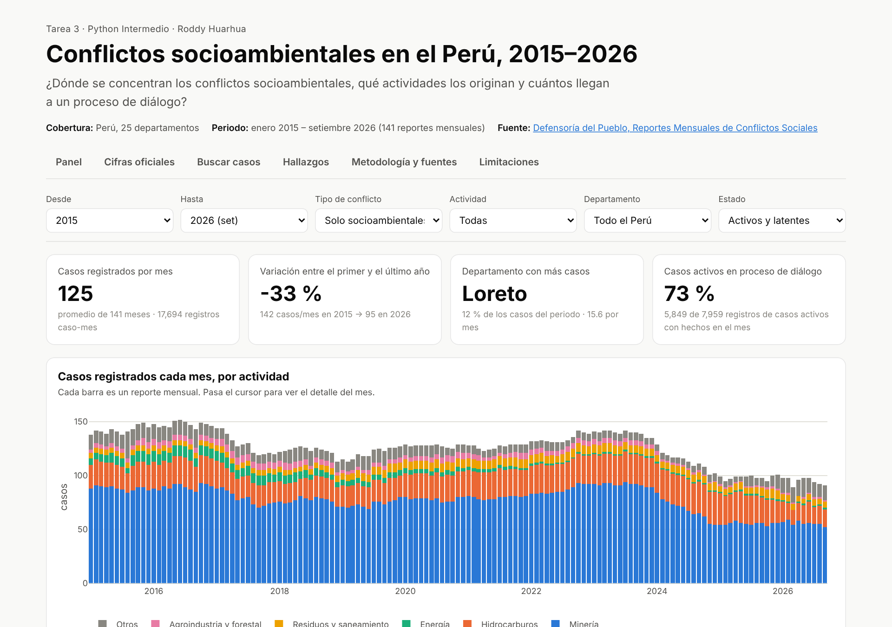
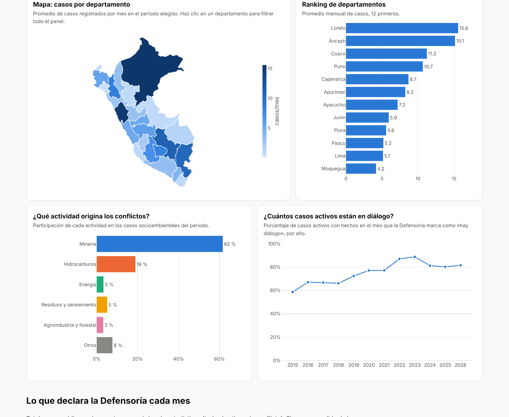

# Tarea 3 – Conflictos socioambientales en el Perú, 2015–2026

**Autor:** Roddy Huarhua · Python Intermedio (d2cml-ai/Data-Science-Python, issue #197)

| Producto | Enlace |
|---|---|
| Dashboard público | https://roddyhuarhua-hub.github.io/Data-Science-Python/ |
| Reel | [`reel/reel.mp4`](reel/reel.mp4) |
| Publicación de LinkedIn | _pendiente_ |
| Código | esta carpeta (`tarea_3/`, rama `tarea-3`) |

## Tema y pregunta de investigación

Trabajo en relaciones comunitarias y estudié conflictos socioambientales. Para esta tarea usé los reportes mensuales de la Defensoría del Pueblo y me pregunté:

> **¿Dónde se concentran los conflictos socioambientales en el Perú, qué actividades los originan y cuántos llegan a un proceso de diálogo?**

- **Cobertura geográfica:** Perú, 25 departamentos (más casos nacionales o multirregionales).
- **Cobertura temporal:** enero 2015 – setiembre 2026, con 141 reportes mensuales (N.° 131 a N.° 271).

## Descripción del proyecto

1. Se descargaron los 141 Reportes Mensuales de Conflictos Sociales y se armó una base con **una fila por caso y por mes** (28 166 filas).
2. Se limpió la base, se normalizó el departamento con el ubigeo del INEI y se clasificó cada caso socioambiental por **actividad**: minería, hidrocarburos, energía, residuos y saneamiento, agroindustria y forestal, u otros.
3. La base se **validó** contra el total que declara cada reporte. La diferencia mediana es 0 casos por mes.
4. Con eso se construyeron un **dashboard interactivo** (4 KPIs, mapa y 7 gráficos más, 7 filtros, buscador de casos y descarga de CSV) y un **reel** de 1 minuto narrado con mi voz clonada.



## Fuentes de datos

| Fuente | Qué se usó | Enlace |
|---|---|---|
| Defensoría del Pueblo – Reportes Mensuales de Conflictos Sociales N.° 131–271 | Fichas de casos activos, tablas de casos sin hechos nuevos y latentes, y cifras de la página de estadísticas (registrados, nuevos, resueltos, diálogo, fallecidos y heridos) | https://www.defensoria.gob.pe/?s=reporte+de+conflictos+sociales (enlace de cada reporte en `datos/originales/fuentes_por_mes.csv` y `catalogo_reportes.csv`) |
| INEI – ubigeo y límites departamentales | Normalizar el departamento y dibujar el mapa | `web/data/departamentos.geojson` |

Fecha de descarga: 27 y 28 de octubre de 2026. Dos meses (N.° 142 y N.° 173) se tomaron del espejo oficial sinia.minam.gob.pe. Los PDF pesan unos 400 MB y no se suben: `scripts/obtener_datos.py` los vuelve a descargar.

## Metodología

| Paso | Script | Salida |
|---|---|---|
| Descarga de reportes y texto | `scripts/obtener_datos.py` | `datos/originales/catalogo_reportes.csv` (PDF y texto, fuera de git) |
| Base por caso ene 2015 – set 2024 | preparada desde los PDF (ver `datos/originales/LEEME_base_defensoria.md`) | `datos/originales/defensoria_casos_por_mes_2015_2026.csv` |
| Reextracción oct 2024 – set 2026 (cambió el formato de las tablas) | `scripts/completar_2024_2026.py` | `datos/procesados/casos_2024_10_a_2026_09.csv` |
| Cifras oficiales de cada reporte | `scripts/extraer_resumen_oficial.py` | `datos/procesados/resumen_oficial.csv` |
| Limpieza y actividad | `scripts/procesar_datos.py` + `scripts/actividad.py` | `datos/procesados/casos_limpios.csv`, `panel_mensual.csv` |
| Indicadores y datos del dashboard | `scripts/analizar_datos.py` | `datos/procesados/indicadores_anuales.csv`, `hallazgos.json`, `web/data/*.json` |
| Gráficos y video del reel | `reel/hacer_graficos.py`, `reel/hacer_reel.py` | `reel/recursos/escena_*.png`, `reel/reel.mp4` |

**Indicadores principales**
- *Casos registrados por mes* = casos activos + latentes de cada reporte.
- *% socioambiental* = casos socioambientales / casos registrados.
- *Actividad*: palabras clave en la descripción del caso (empresas, «minera», «lote», «oleoducto», «hidroeléctrica», etc.). Da 62 % minería y 19 % hidrocarburos. La Defensoría declara, en promedio, 64 % y 19 %.
- *% en diálogo*: casos socioambientales activos con hechos en el mes que la Defensoría marca «hay diálogo», entre los que traen ese dato.
- *Nuevos, resueltos, fallecidos y heridos*: suma de lo que declara cada reporte (todos los tipos de conflicto).

## Tres hallazgos

1. **Seis de cada diez conflictos socioambientales son mineros.** Los socioambientales son el **63 %** de todos los casos registrados entre 2015 y 2026. De ellos, el **62 %** está ligado a la minería y el **19 %** a los hidrocarburos.
2. **Cinco departamentos concentran la mitad.** Loreto, Áncash, Cusco, Puno y Cajamarca suman el **50 %** de los registros socioambientales. Loreto tiene el **61 %** de todos los conflictos por hidrocarburos del país, y el 93 % de sus conflictos socioambientales son petroleros.
3. **Más diálogo, pocos casos resueltos.** Los casos socioambientales activos con un proceso de diálogo subieron de **59 % en 2015** a **80 % o más desde 2022**. Pero entre 2015 y 2026 los reportes declaran **597 casos nuevos y solo 242 resueltos**: por cada conflicto que se cierra aparecen dos o tres nuevos.

Además, el número de conflictos socioambientales bajó de unos 139 por mes en 2023 a unos 96 en 2025–2026 (cifra oficial). En el mismo periodo, el total de conflictos bajó menos (de 221 a 197 por mes) porque crecieron los de asuntos de gobierno nacional.



## Limitaciones

- Un «caso registrado» es un conflicto que la Defensoría sigue ese mes. No mide la intensidad del conflicto, cuántas personas participan ni si hubo violencia.
- La extracción desde PDF es automática. En 10 de los 24 meses desde octubre 2024 el conteo difiere en 1 a 3 casos del total oficial, y en marzo 2026 en 13 casos, porque el propio reporte no cuadra (59 fichas + 88 sin hechos ≠ 161 declarados). El reporte N.° 249 declara 209 registrados en su página de estadísticas, pero su portada da 194 (154 + 40); se usó 194.
- La actividad se asignó por palabras clave, y alrededor del 8 % de los socioambientales quedó como «Otros». Desde octubre 2024, los casos sin hechos nuevos y los latentes solo traen un nombre corto, así que su actividad es menos precisa.
- Desde mediados de 2024 la Defensoría no informa el diálogo de los casos activos sin hechos nuevos. Por eso el indicador usa solo los casos con hechos en el mes.
- Los casos nuevos, resueltos, fallecidos y heridos abarcan todos los tipos de conflicto, no solo los socioambientales. En esa serie falta el N.° 136 (junio 2015).
- No hay un código estable por caso (aparece en menos del 1 % de las filas), así que no se mide cuánto dura cada conflicto.

## Cómo reproducir

```bash
cd tarea_3
pip install -r requirements.txt
python scripts/obtener_datos.py          # opcional: descarga los 141 reportes (~400 MB)
python scripts/procesar_datos.py         # limpieza y actividad
python scripts/analizar_datos.py         # indicadores y datos del dashboard
python -m http.server -d web 8000        # abrir http://localhost:8000
python reel/hacer_graficos.py            # gráficos del reel
python reel/hacer_reel.py --prueba --musica reel/recursos/bach_preludio_do.wav   # video con voz de relleno
```

Para el reel con voz clonada hace falta el entorno de la Sesión 15 (`qwen-tts`, `faster-whisper`, `librosa`) y una nota de voz propia de 15 a 25 s. Se ejecuta así: `python reel/hacer_reel.py --voz mi_voz.wav --musica reel/recursos/bach_preludio_do.wav`. La nota de voz original no se publica.

El dashboard es HTML + Plotly.js, sin servidor. La rama `gh-pages` contiene una copia de `web/` y GitHub Pages la publica.

## Reel

- 7 escenas, unos 60 s, formato 1080 × 1920. Guion con la fuente de cada cifra en [`reel/guion.json`](reel/guion.json) y subtítulos en [`reel/subtitulos.srt`](reel/subtitulos.srt).
- **Voz generada con IA** (Qwen3-TTS) a partir de una grabación de mi propia voz. El aviso aparece en pantalla durante todo el video.
- Imágenes: gráficos y mapa hechos con los datos del proyecto, más una captura del dashboard.
- Música: J. S. Bach, Preludio en Do mayor BWV 846 (dominio público), interpretado con un piano sintetizado propio (`reel/recursos/musica_bach.py`), a menor volumen que la voz.

## Uso de inteligencia artificial

Usé Claude (Anthropic) para escribir y revisar el código de descarga, limpieza, análisis, dashboard y reel, para proponer el guion y para redactar la documentación. La voz del reel se generó con Qwen3-TTS a partir de mi grabación, y los subtítulos se alinearon con faster-whisper. Revisé las cifras contra los reportes de la Defensoría: la base se comparó mes a mes con el total oficial y las cifras del guion salen de `datos/procesados/hallazgos.json` y `resumen_oficial.csv`. Las interpretaciones son mías.
