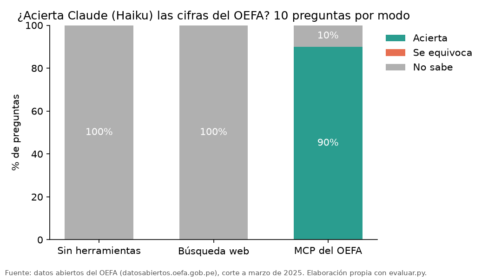

# Informe · ¿Inventa Claude cifras del OEFA?

Hice las 10 preguntas de `preguntas.csv` a Claude Haiku con `claude -p` en tres modos: sin herramientas
(memoria), con búsqueda web y con nuestro MCP del OEFA. Cada pregunta pide una cifra de fiscalización
ambiental (denuncias SINADA, supervisiones, medidas, multas firmes, resoluciones y expedientes del TFA). La
cifra de referencia sale de los xlsx originales del portal, calculada con pandas en `scripts/verdades.py`.

## Resultados

Corrida final (`resultados.csv`, `uv run evaluar.py --modos memoria web mcp --paralelo 2`):

| Modo | Acierta | Se equivoca | No sabe | Segundos promedio |
|---|---|---|---|---|
| Memoria | 0 | 0 | 10 | 16.2 |
| Búsqueda web | 0 | 0 | 10 | 66.8 |
| MCP del OEFA | 9 | 0 | 1 | 18.1 |

La corrida base (`resultados_base.csv`, solo memoria y MCP) dio memoria 0/10 con 10 «no sé» y MCP 8/10 con
2 «no sé», en 22.8 y 26.4 segundos promedio.

## Qué falló cada modo y por qué

- **Memoria (10 «no sé»).** Haiku no tiene estas cifras. En la columna `fuente` responde cosas como «sin acceso
  a los datos del SINADA/OEFA». Lo bueno es que no inventó ninguna: la instrucción le permite poner `null`.
- **Búsqueda web (10 «no sé»).** Encontró el portal, pero no pudo usarlo. Las respuestas dicen que el dataset
  «requiere descargar y procesar los datos» o «requiere filtrar por año 2024». Los datos del OEFA son registros
  en Excel, no cifras escritas en una página, así que buscar no basta: hay que contar. En SINADA 2024 encontró una
  nota de prensa con 6,468 denuncias para enero 2024 - julio 2025, otro periodo, y no la usó. También tardó
  cuatro veces más que el MCP (hasta 122 segundos en una pregunta).
- **MCP (1 «no sé»).** Falló `rd_2024`, que pregunta cuántas resoluciones directorales emitió «la Dirección de
  Fiscalización y Aplicación de Incentivos». Claude vio el total correcto (1,705), pero respondió que el dataset
  «no incluye campo de dirección emisora» y prefirió no afirmarlo. En la corrida base pasó lo mismo con
  `supervision_2023`, que dice «aprobó»: vio los 6,096 informes, pero no un campo de aprobación. En la corrida
  final sí la respondió. Los dos «no sé» vienen de la redacción de la pregunta, no del servidor. Una pregunta con
  palabras que el dataset no tiene hace dudar al modelo, y eso está bien: es preferible a una cifra inventada.

## Dos cifras comprobadas a mano

| Pregunta | Cifra del MCP | Vista en el portal | Estado |
|---|---|---|---|
| Denuncias SINADA en Cajamarca en 2024 | 133 | [Denuncias SINADA 2019-2025](https://datosabiertos.oefa.gob.pe/dataviews/262247/denuncias-sinada-2019-2025/) | Comprobada a mano por Roddy Huarhua en el portal del OEFA el 28/10/2026 |
| Resoluciones directorales emitidas en 2024 | 1,705 | [Resoluciones directorales 2018-2025](https://datosabiertos.oefa.gob.pe/dataviews/262238/resoluciones-directorales-2018-2025/) | Comprobada a mano por Roddy Huarhua en el portal del OEFA el 28/10/2026 |

## Limitaciones

- Los datos llegan hasta febrero o marzo de 2025: el portal los actualizó por última vez el 29/04/2025.
- Las 560 denuncias SINADA de 2025 no tienen departamento, así que no aparecen en los filtros por territorio.
- Las multas firmes se suman en soles (`MULTA (SOLES)`), porque la columna en UIT a veces trae soles por error.
- Los informes de supervisión no traen ubicación. El servidor toma el departamento de la misma unidad
  fiscalizable en otros datasets, y cerca de 1 de cada 4 informes queda sin departamento.
- Son 10 preguntas y una sola corrida por modo con Haiku. Entre la corrida base y la final, una pregunta del MCP
  cambió de «no sé» a acierto.

## Conclusión

Para relaciones comunitarias, un MCP vale la pena cuando la pregunta exige **contar o cruzar registros** de una
fuente oficial: cuántas denuncias hubo en una provincia, qué empresas acumulan multas o qué medidas se dictaron
antes de una visita a campo. La búsqueda web no hace eso. Encuentra el dataset, pero no lo procesa. En nuestras
preguntas acertó 0 de 10 y tardó cuatro veces más. El MCP acertó 9 de 10 citando el dataset y el periodo, que es
lo que se necesita para sostener una cifra frente a una comunidad o una empresa. La búsqueda web basta para
contexto que ya está escrito, como noticias, normas o conflictos reportados. Para las cifras, conviene un MCP.
