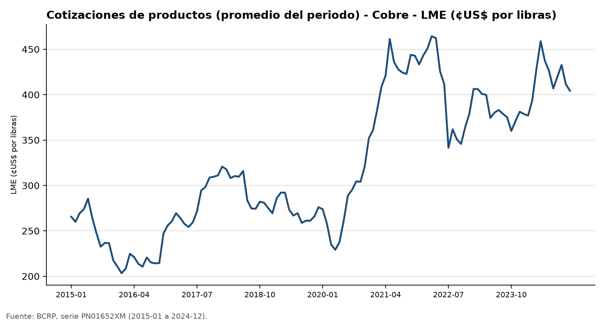
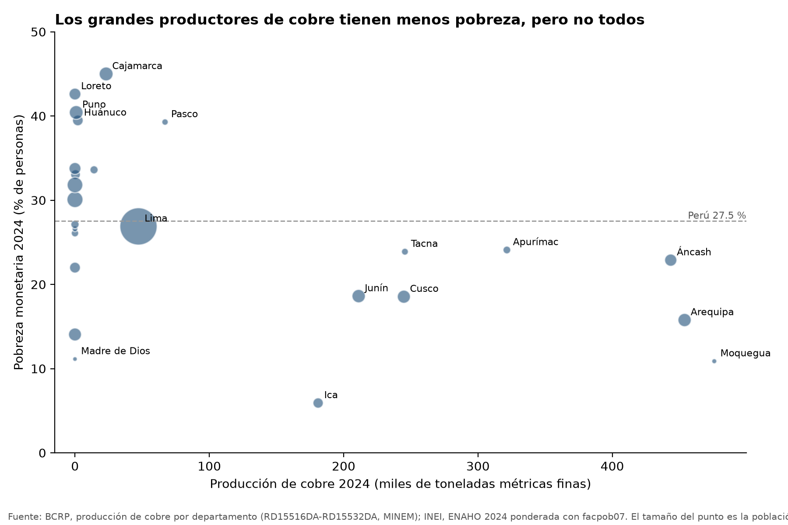
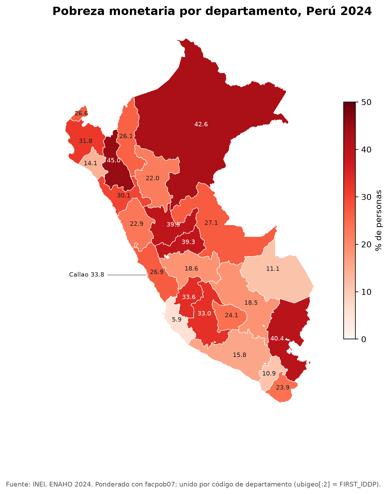
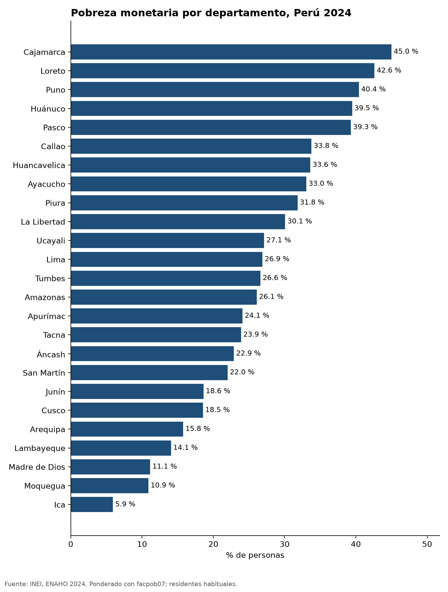
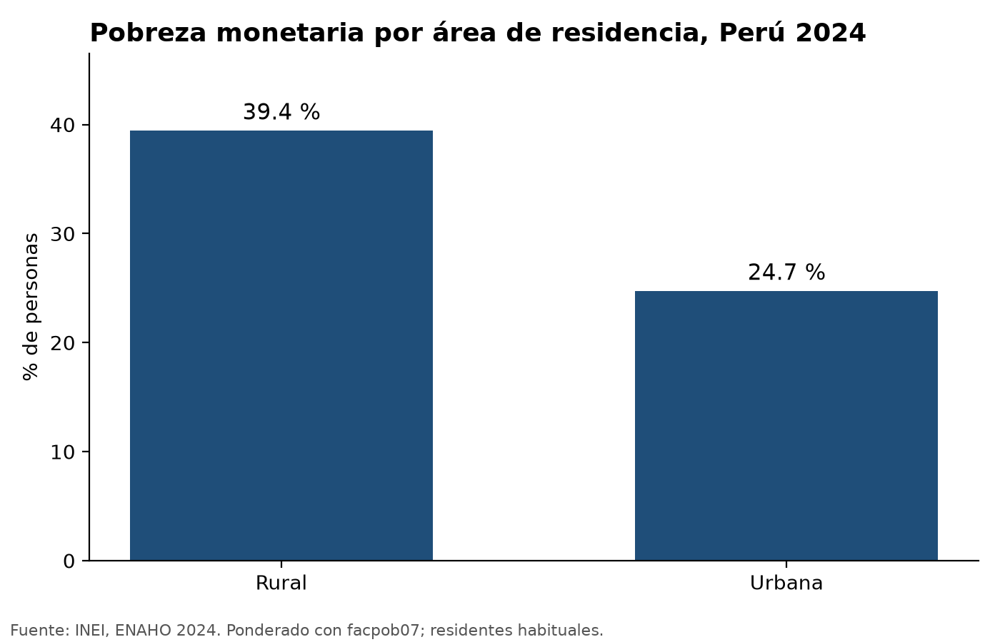

# Cobre, oro y pobreza monetaria por departamento, Perú 2024

**Autor:** Roddy Huarhua · **Curso:** Data-Science-Python, Tarea 4 (issue #201) · **Fecha:** noviembre de 2026

## 1. Pregunta de investigación

En 2024, con precios altos del cobre y del oro, **¿los departamentos que más cobre producen tienen menos pobreza
monetaria que el resto del Perú?**

En las relaciones comunitarias de la gran minería, la expectativa de desarrollo local es una de las fuentes
principales de conflicto socioambiental. Antes de discutir si la minería «trae desarrollo», conviene ver qué dicen
juntas las dos fuentes oficiales: cuánto produce cada departamento (BCRP, con datos del MINEM) y cuánta pobreza
tiene (INEI, ENAHO). Este informe es **descriptivo y de un solo año**: muestra asociaciones, no causas.

**Plan.** (1) Precios del cobre y del oro con el MCP del BCRP; (2) ranking de producción de cobre por
departamento con la herramienta propia; (3) base ENAHO validada con la skill de limpieza; (4) mapa y gráficos con
las skills; (5) pobreza de los grandes productores frente al resto, uniendo por código de departamento.

## 2. Fuentes y metodología

| Fuente | Qué se usó | Cómo se obtuvo |
|---|---|---|
| BCRP, cotizaciones internacionales | Cobre LME anual **PM05568XA** y mensual **PN01652XM** (¢US$/lb); oro LBMA anual **PM05570XA** (US$/oz troy) | MCP `bcrp`: `buscar_series`, `serie`, `resumen`, `graficar_serie` |
| BCRP, «Producción de productos mineros según departamentos» (datos del MINEM) | Cobre 2024 por departamento, series anuales **RD15516DA** (total) a **RD15532DA**, en tm.f | Herramienta propia `produccion_minera_departamental` |
| INEI, ENAHO 2024 (código 966) | Módulo 34 (sumaria) y módulo 02 (miembros del hogar) | Skill `limpiando-enaho` → `salidas/personas_2024.parquet` |
| Límites departamentales | `peru_departamental_simple.geojson` del repositorio del curso | Skill `mapeando-enaho` |

**Procesamiento ENAHO.** Residentes habituales `((p204==1)&(p205==2))|((p204==2)&(p206==1))`; unión personas–hogar
con `validate="m:1"`; pobre = `pobreza <= 2`; toda tasa ponderada con `facpob07`. La validación
([`salidas/validacion.txt`](../salidas/validacion.txt)) pasó los 15 chequeos: pobreza 27.58 % (INEI 27.6 %),
urbana 24.81 %, rural 39.30 %, 108,664 residentes, 25 códigos territoriales.

**Unión de fuentes.** La herramienta propia devuelve el código INEI de cada departamento (`ccdd`); se une con
`ubigeo[:2]` de la ENAHO, nunca por nombre (el BCRP escribe «Apurimac» y «Ancash» sin tilde).

**Definición.** «Grandes productores de cobre» son los cinco departamentos con más producción de cobre en 2024.
La tasa del grupo se pondera por población (no es el promedio de las cinco tasas).

**Ejecución.** Todo salió de una sola corrida de Claude Code con el MCP y las tres skills
([`evidencias_ia/integracion/ejecucion.md`](../evidencias_ia/integracion/ejecucion.md)): 9 llamadas al MCP
(`buscar_series`, `produccion_minera_departamental`, `resumen`, `serie`, `graficar_serie`), luego
`limpiando-enaho` → `mapeando-enaho` → `graficando-enaho`. El borrador del agente está en
[`borrador_agente.md`](borrador_agente.md); este informe lo revisa, verifica las cifras y agrega la tabla y el gráfico
de dispersión de [`scripts/analisis_minero.py`](../scripts/analisis_minero.py).

## 3. Resultados

### Hallazgo 1. 2024 fue un año de precios altos, sobre todo para el oro

El cobre promedió **414.6 ¢US$/lb** en 2024, frente a 384.8 en 2023: **+7.8 %** (BCRP, PM05568XA). El oro pasó de
US$ 1,943.4 a **US$ 2,388.0** por onza troy: **+22.9 %** (BCRP, PM05570XA). En la serie mensual, el cobre de 2024
estuvo entre los niveles más altos de la década (figura 1), solo comparable con 2021-2022.



*Figura 1. Cotización mensual del cobre LME, 2015-2024. Fuente: BCRP, serie PN01652XM (gráfico de `graficar_serie`).*

### Hallazgo 2. Los cinco grandes productores de cobre tienen 9 puntos menos de pobreza que el resto del país

En 2024 se produjeron **2,732,642 tm.f** de cobre. Cinco departamentos concentran el **71 %**: Moquegua (475,930
tm.f; 17.4 %), Arequipa (453,836; 16.6 %), Áncash (443,516; 16.2 %), Apurímac (321,527; 11.8 %) y Tacna (245,627;
9.0 %) (BCRP, RD15529DA, RD15519DA, RD15517DA, RD15518DA, RD15532DA).

| Grupo | Pobreza monetaria 2024 | Población |
|---|---|---|
| Cinco grandes productores de cobre | **19.7 %** | 3.66 millones (10.7 %) |
| Resto del país (20 departamentos) | **28.5 %** | 30.5 millones |
| Resto sin Lima ni Callao | 29.1 % | |
| Perú | 27.5 % (personas, `facpob07`) · 27.6 % oficial | 34.1 millones |

Fuente: INEI, ENAHO 2024, ponderado con `facpob07`; agrupación por el ranking del BCRP. Cálculo:
[`salidas/indicadores.csv`](../salidas/indicadores.csv) y [`scripts/analisis_minero.py`](../scripts/analisis_minero.py).

### Hallazgo 3. La ventaja no es pareja: Moquegua y Arequipa bajan el promedio, y producir cobre no basta

Dentro del grupo, Moquegua (10.9 %) y Arequipa (15.8 %) tienen poca pobreza, pero Áncash (22.9 %), Tacna (23.9 %) y
Apurímac (24.1 %) están apenas 3 a 5 puntos por debajo del promedio nacional. Fuera del grupo, departamentos con
producción de cobre tienen pobreza alta: **Cajamarca 45.0 %**, la más alta del país, y **Pasco 39.3 %**. Y el
departamento con menos pobreza, **Ica (5.9 %)**, es el octavo productor. Si se toman los 15 departamentos con
alguna producción de cobre, su pobreza (27.1 %) es casi igual a la de los 10 sin cobre (28.6 %): la diferencia del
hallazgo 2 está concentrada en los productores más grandes, no en «ser minero». La correlación de rangos entre
producción de cobre y pobreza en los 25 departamentos es negativa pero débil (Spearman −0.33).

Con el oro el patrón es aún menos claro. Los tres mayores productores de oro en 2024 fueron **La Libertad** (32.8 %
del oro del país; pobreza 30.1 %), **Arequipa** (21.0 %; 15.8 %) y **Cajamarca** (19.1 %; 45.0 %) (BCRP, series
RD15543DA a RD15560DA, en gramos finos). Es decir, dos de los tres grandes productores de oro tienen pobreza igual o
mayor que el promedio nacional.



*Figura 2. Producción de cobre 2024 (BCRP) y pobreza monetaria 2024 (ENAHO) por departamento; el tamaño del punto es
la población. Tabla completa, con cobre y oro: [`salidas/mineria_pobreza_2024.csv`](../salidas/mineria_pobreza_2024.csv).
Fuente: `scripts/analisis_minero.py`.*

### Hallazgo 4. El mapa de la pobreza sigue la sierra norte, la selva y el altiplano, no el corredor del cobre

Los departamentos con más pobreza son Cajamarca (45.0 %), Loreto (42.6 %) y Puno (40.4 %); los de menos, Ica
(5.9 %), Moquegua (10.9 %) y Madre de Dios (11.1 %). Los grandes productores de cobre del sur (Moquegua, Arequipa,
Tacna) están en la franja de menor pobreza, junto con Ica y Madre de Dios, que no lo son. La brecha urbano-rural
(rural 39.4 %, urbana 24.7 %; figura 4) es tan grande como la diferencia entre productores y no productores.



*Figura 3. Pobreza monetaria por departamento, 2024. 25 unidades, Lima y Callao separados, unión por código.
Fuente: INEI, ENAHO 2024 (skill `mapeando-enaho`). Diferencia máxima con la referencia de la Sesión 16: 0.52 puntos.*




*Figura 4. Pobreza monetaria por departamento y por área de residencia, 2024. Fuente: INEI, ENAHO 2024 (skill
`graficando-enaho`), ponderado con `facpob07`.*

## 4. Interpretación

Los datos son compatibles con la idea de que la gran minería del cobre convive con menos pobreza en algunos
territorios del sur, pero **no la demuestran**. Moquegua, Arequipa y Tacna están en la costa sur y tienen ciudades grandes,
rasgos que también se asocian con menos pobreza; este análisis no puede separar un factor del otro. Cajamarca y
Pasco, con producción minera, muestran que minería y pobreza alta pueden coexistir. Para el trabajo de relaciones
comunitarias, la lectura práctica es que el promedio del «departamento minero» esconde mucho: Apurímac, el cuarto
productor de cobre del país, tiene una pobreza (24.1 %) parecida a la de Tumbes (26.6 %) o Lima (26.9 %). La
expectativa de desarrollo que genera un proyecto no se traduce sola en menos pobreza departamental, y ese desfase
es terreno de conflicto.

## 5. Verificación manual de cifras

| # | Afirmación | Valor del agente | Verificación | Fuente / procedimiento | ¿Coincide? |
|---|---|---|---|---|---|
| 1 | Precio promedio del cobre LME 2024 | 414.62 ¢US$/lb | 414.62 | Web del BCRP, tabla anual [PM05568XA](https://estadisticas.bcrp.gob.pe/estadisticas/series/anuales/resultados/PM05568XA/html), revisada a mano; también `scripts/verdades.py` (API directa) | **Sí**, revisado a mano el 3-11-2026: la web muestra 414,62 |
| 2 | Producción de cobre de Apurímac 2024 | 321,527.1 tm.f | 321,527.1 | Web del BCRP, tabla anual [RD15518DA](https://estadisticas.bcrp.gob.pe/estadisticas/series/anuales/resultados/RD15518DA/html); también prueba automática con datos reales | **Sí**, revisado a mano el 3-11-2026: la web muestra 321527 ([captura](../evidencias_ia/verificacion/bcrp_RD15518DA_apurimac_cobre.png)) |
| 3 | Pobreza monetaria nacional 2024 | 27.58 % (sumaria) · 27.53 % (personas) | 27.6 % | INEI, cifra oficial de pobreza monetaria 2024; diferencia −0.02 puntos | Sí (tolerancia 0.1) |
| 4 | Pobreza de Cajamarca 2024 | 44.99 % | 45.0 % | Referencia del curso (`sessions/16-skills-enaho/referencias`) y `verdades.py` con la sumaria: 45.01 % | Sí |
| 5 | Pobreza conjunta de los 5 grandes productores | 19.75 % (personas, `facpob07`) | 19.74 % | `verdades.py`: otro camino (API directa del BCRP + sumaria ponderada por hogar) | Sí, diferencia 0.01 |

Diferencias observadas: la ENAHO admite dos ponderaciones (por hogar `factor07 × mieperho`, que replica la cifra
oficial, y por persona `facpob07`); difieren hasta 0.5 puntos en algunos departamentos (Puno) y 0.14 en el área
rural. Ninguna cambia los hallazgos.

**Errores y su manejo.** La API del BCRP a veces responde con una página HTML en vez de JSON; el servidor reintenta
con pausa y, si no lo logra, devuelve un error claro en lugar de un número. Si la validación de la ENAHO falla, la
skill no guarda la base y el agente debe detenerse. En la primera ejecución integrada el agente leyó los SKILL.md y
corrió los scripts sin invocar la herramienta Skill; se repitió pidiendo invocarlas explícitamente.

## 6. Limitaciones

- **Un solo año y sin causalidad.** Se compara producción y pobreza de 2024; no hay serie de tiempo ni controles
  (urbanización, Lima, otros sectores, canon). Los precios se describen 2023-2024, pero no se mide su efecto.
- **Escala departamental.** La pobreza de los distritos mineros puede ser muy distinta de la de su departamento.
- **Producción absoluta.** El grupo se definió por toneladas, no por el peso de la minería en la economía regional
  (el PBI departamental del BCRP solo llega a 2023).
- **Solo cobre en el ranking.** El oro se describe (hallazgo 3) pero no se usa para agrupar; otros metales no se analizan.
- **Error muestral.** No se calcularon intervalos de confianza; las diferencias de 1 a 3 puntos entre departamentos
  (por ejemplo Áncash, Tacna y Apurímac) pueden no ser significativas.
- **Ponderación.** Las cifras por persona (`facpob07`) difieren algunas décimas de las oficiales por hogar.

## 7. Reproducibilidad

```bash
cd tarea_4
uv sync
uv run pytest -q                                                    # 10 passed
uv run .claude/skills/limpiando-enaho/scripts/limpiar.py --anio 2024 # TODO OK (necesita los zip en datos/)
uv run scripts/analisis_minero.py                                   # tabla y figura 2
uv run scripts/ejecucion_integrada.py                               # la corrida completa con Claude Code
```

Datos: ENAHO 2024 módulos 34 y 02 del [portal del INEI](https://proyectos.inei.gob.pe/microdatos/) (ver README);
series del BCRP por su API pública, sin clave.
