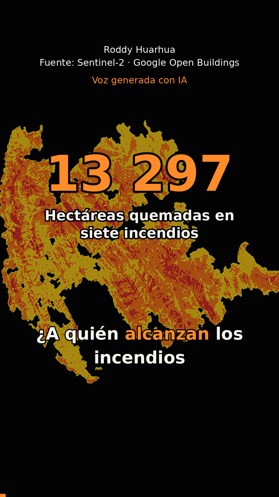

# ¿A quién alcanza el fuego? · Del informe al reel

Sesión 15 · Del texto a tu voz · Data Science con Python · 24 de octubre de 2026 · Roddy Huarhua

**Reel:** [`salidas/reel.mp4`](salidas/reel.mp4) (49 s, vertical 1080 × 1920) · **Posts:** [`salidas/posts.md`](salidas/posts.md)



## El texto largo

El informe de mi tarea del 21 de octubre ([reto D, PR #193](https://github.com/d2cml-ai/Data-Science-Python/pull/193)):
siete incendios del sur andino (Apurímac, Cusco y Arequipa), su área quemada con dNBR de Sentinel-2 y las
edificaciones de Google Open Buildings dentro o cerca del borde. Está en [`texto_fuente.md`](texto_fuente.md).

## El flujo

| Paso | Herramienta | Archivo |
|---|---|---|
| 1. Texto → guion en JSON (6 escenas) y 3 posts | Qwen3.7 en chat.qwen.ai, con el prompt de `guion.py` | [`prompt.txt`](prompt.txt) → [`respuesta_qwen.txt`](respuesta_qwen.txt) |
| 2. Verificar cifras | `guion.py`: marca con ¡¡ las cifras que no están en el texto | — |
| 3. Revisar frases contra la fuente | yo | [`salidas/guion.json`](salidas/guion.json) |
| 4. Voz clonada (15 s de referencia) | Qwen3-TTS 0.6B en CPU, 10 % más rápida con `atempo` | `hacer_reel.py` |
| 5. Control y subtítulos | faster-whisper: repite la escena si entiende mal más del 25 % | [`salidas/reel.srt`](salidas/reel.srt) |
| 6. Video | Pillow dibuja cada cuadro y ffmpeg lo une; música de fondo con `sidechaincompress` | [`salidas/reel.mp4`](salidas/reel.mp4) |

Todo se corre desde [`reel_paso_a_paso.ipynb`](reel_paso_a_paso.ipynb).

## Qué corregí del guion y por qué

La verificación automática pasó: las seis cifras estaban tal cual en el informe. Pero tres frases afirmaban más
de lo que dice la fuente.

| Qwen escribió | El informe dice | Lo dejé así |
|---|---|---|
| «En Alto Pichigua hay cero coma cinco personas por edificación, **pues son corrales**.» | Una edificación **puede ser** corral, depósito o local comunal. | «…Puede ser corral, depósito o local comunal.» |
| «…**confirmando que el peligro real** está en la periferia.» | «El riesgo está en el borde, no en el centro.» | «El riesgo está en el borde, no en el centro.» |
| Post de Facebook: «**¡La ciencia de datos salva vidas!**» y, en X, el emoji 🌲 | Nada sobre vidas salvadas; los incendios fueron en pastizal y matorral, no en bosque. | Lo quité, y «datos de 2023» pasó a «2023 o antes». |

También pasé el guion a primera persona («Analicé») porque el trabajo lo hice yo.

Las dos primeras son el mismo error que mostró el profesor: una posibilidad se vuelve certeza y un hallazgo
prudente se vuelve «peligro real». En relaciones comunitarias, afirmar sin pruebas que un lugar está o no habitado
es justo el tipo de error que genera conflicto.

## Lo que salió mal y cómo se resolvió

- **Whisper oía mal.** Escribió «Zikwani» por Sicuani, «Aquí en alcanzan» por «¿A quién alcanzan» y partía
  las cifras («13 .297», «0 ,5»). Los subtítulos ahora usan el texto revisado del guion con los tiempos de Whisper
  (`alinear_con_guion` en `hacer_reel.py`).
- **PyAV.** `faster-whisper` no podía abrir archivos por la versión de PyAV; se le pasa el audio ya leído con librosa.
- **Windows.** El archivo de voz era `Mi_voz.m4a.mp4` (Windows oculta la extensión); el visor de VS Code no
  reproduce el audio de los mp4.
- **Música.** Las grabaciones de música clásica casi siempre tienen derechos. Por eso el Preludio en Do mayor de
  Bach (BWV 846, dominio público) se genera nota por nota con numpy ([`musica_bach.py`](musica_bach.py)).

## Cómo correrlo

```bash
python -m venv .venv            # Python 3.12
.venv\Scripts\python -m pip install -r requirements.txt
.venv\Scripts\python guion.py --texto texto_fuente.md --solo-prompt > prompt.txt
.venv\Scripts\python guion.py --texto texto_fuente.md --respuesta respuesta_qwen.txt
# revisar salidas/guion.json contra el texto
.venv\Scripts\python musica_bach.py
.venv\Scripts\python hacer_reel.py --voz mi_voz.wav --velocidad 1.1 --musica musica/bach_preludio_do.wav ^
    --autor "Roddy Huarhua" --fuente "Sentinel-2 · Google Open Buildings" --imagenes imagenes/*
```

Mi grabación de voz no está en el repo. La voz del reel está generada con IA a partir de mi propia voz, y así lo
dice el video y cada post.
